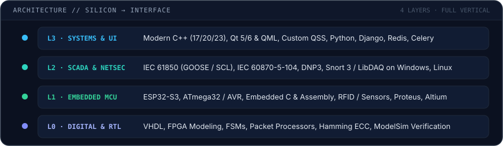
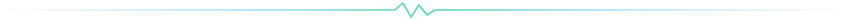

  

  
  
  

 

  

 

  

## Selected Engineering Work

<table>
  <tr>
    <td width="50%" valign="top">
      <h3>🛡️ <a href="https://github.com/Mahbodbe/snort3-windows">snort3-windows</a></h3>
      
Windows integration and reproducible build environment for <b>Snort 3</b> and <b>LibDAQ</b> — bridging Npcap, native toolchains, and high-speed packet inspection on Windows.

      

        
        
        
      

    </td>
    <td width="50%" valign="top">
      <h3>⚡ <a href="https://github.com/Mahbodbe/goose-lab">goose-lab</a></h3>
      
<b>GOOSE / IEC 61850</b> protocol analyzer in Python — raw Ethernet frame parsing (<code>0x88B8</code>, <code>stNum</code>/<code>sqNum</code>), multicast latency experiments, and SCL substation topology graphs.

      

        
        
        
      

    </td>
  </tr>
  <tr>
    <td width="50%" valign="top">
      <h3>🖥️ <a href="https://github.com/Mahbodbe/Qt-Deep-Dive">Qt-Deep-Dive</a></h3>
      
14-chapter hands-on study series on production <b>Qt 5/6</b> and <b>QML</b> architecture, refactored with modern C++17/20 idioms and custom dark QSS themes. Bilingual <b>EN / FA</b>.

      

        
        
        
      

    </td>
    <td width="50%" valign="top">
      <h3>🔬 <a href="https://github.com/Mahbodbe/HammingProject">HammingProject</a></h3>
      
RTL <b>VHDL packet processor</b> implementing single-error-correcting <b>Hamming ECC</b>, verified end-to-end with testbenches in ModelSim. Paired with <a href="https://github.com/Mahbodbe/VHDL-Learning-Project">VHDL-Learning-Project</a>.

      

        
        
        
      

    </td>
  </tr>
  <tr>
    <td width="50%" valign="top">
      <h3>🅿️ <a href="https://github.com/Mahbodbe/smart-parking">smart-parking</a></h3>
      
<b>ESP32-S3</b> smart parking controller featuring ultrasonic/IR sensing, servo barrier actuation, real-time LCD status display, and telemetry sync (AUT EE project).

      

        
        
        
      

    </td>
    <td width="50%" valign="top">
      <h3>🌐 <a href="https://github.com/Mahbodbe/nomoreidea">nomoreidea.ir</a></h3>
      
Personal EE portfolio site wired directly to the GitHub API — live repository cards, bilingual EN/FA interface, and curated hardware/software index.

      

        
        
      

    </td>
  </tr>
</table>

  
<b>More Hardware, Systems &amp; Coursework Repositories</b>

   

| Repository | Focus | Stack |
| :--- | :--- | :--- |
| [**DoorLock**](https://github.com/Mahbodbe/DoorLock) | Smart RFID door-lock system (MFRC522, PIR, ESP32) — phased hardware build | `ESP32` · `RFID` · `Embedded` |
| [**Logic-Circuit-C**](https://github.com/Mahbodbe/Logic-Circuit-C) | ATmega32 embedded-C exercises (7-seg, keypad, LCD) with Proteus simulations | `ATmega32` · `AVR` · `Proteus` |
| [**AP1405**](https://github.com/Mahbodbe/AP1405) | Advanced Programming course projects — AUT EE, Spring 1405 | `C++23` · `Python` · `Algorithms` |
| [**Learning-Qt**](https://github.com/Mahbodbe/Learning-Qt) | Qt5/Qt6 C++ GUI practice projects and interactive examples | `C++` · `Qt` · `GUI` |
| [**sale-bot**](https://github.com/Mahbodbe/sale-bot) | Telegram sales automation bot with order tracking and admin panel | `Python` · `Telegram API` |

 

  

## Tooling & Telemetry

  
  
  
  
  
  
  
  
  
  
  
  
  

  
  

  

  
<b>Certifications &amp; Training</b>

   
  

    
    
    
    
    
    
    
  

 

  

  <i>"The most effective way to understand complex engineering systems is to build them from the silicon up to the user interface."</i>
   
  Open to collaboration on <b>Embedded Firmware</b> · <b>Qt / C++</b> · <b>SCADA &amp; IEC 61850</b> · <b>Network Security</b>

